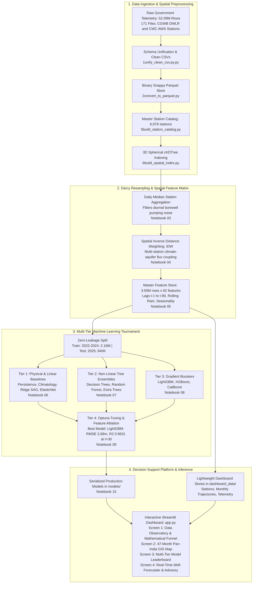

# Pan-India Groundwater Level Forecasting Using Machine Learning & Hydro-Climatic Data
> **B.Tech Project (CE4198P) — Department of Civil Engineering, Indian Institute of Technology (IIT) Guwahati**  
> *A Continental-Scale Spatiotemporal Machine Learning Framework for Multi-Horizon Aquifer Depth Prediction and Tubewell Operational Advisory*

---

## 📌 Executive Summary & Academic Context

* **Institution:** Department of Civil Engineering, IIT Guwahati
* **Course:** B.Tech Project (CE4198P)
* **Supervisor Mandate:** Design and build a **Pan-India machine learning framework** rather than a localized single-district model, integrating heterogeneous government water data across all major Indian hydrogeological provinces (Gangetic alluvial plains, hard-rock basalt Deccan traps, arid Thar desert, and Brahmaputra floodplains).
* **Multi-Horizon Forecasting Targets:**
  * **$t+14$ Days (2 Weeks Ahead):** Immediate tubewell pumping regulation & local irrigation rotation.
  * **$t+30$ Days (1 Month Ahead):** District-scale canal scheduling and reservoir water release planning.
  * **$t+60$ Days (2 Months Ahead):** Seasonal drought mitigation, pre/post-monsoon crop selection, and aquifer recharge planning.
* **Master Scale & Deliverables:**
  * **52,088,570 raw telemetry points** audited across 171 government datasets (CGWB, CWC, IMD, State WRDs).
  * **6,306,419 hardware sensor glitches** (12.11% corruption rate) detected and filtered.
  * **4,879 active Digital Water Level Recorder (DWLR) piezometers** across **28 States and Union Territories**.
  * **Master Feature Store:** `3,003,349 rows × 62 engineered columns` with zero temporal leakage.
  * **Interactive Web Platform:** 4-screen Streamlit decision-support dashboard (`app.py`).

---

## 🏗️ System Architecture & End-to-End Pipeline



---

## 📊 Modeling Tournament Benchmark Results

All models were evaluated under a **strict chronological zero-leakage partition** (Historical Training: October 2022 – December 2024; Out-of-Sample Testing: January 2025 – December 2025 across all Indian wells). Missing values were imputed using training set medians only.

| Model Tier | Algorithm | Features Used | $t+14$ MAE (m) | $t+14$ RMSE (m) | $t+30$ MAE (m) | $t+30$ RMSE (m) | $t+30$ $R^2$ | $t+60$ RMSE (m) |
| :--- | :--- | :--- | :---: | :---: | :---: | :---: | :---: | :---: |
| **Tier 0** | **Physical Persistence** ($GW_{t+k} = GW_t$) | Historical Water Depth | 0.92 m | 2.85 m | 1.62 m | 4.12 m | 0.9520 | 5.86 m |
| **Tier 1** | **Ridge L2 Regularized** ($\alpha=10.0$, SAG) | Autoregressive Lags + Coordinates | 1.06 m | 2.98 m | 1.68 m | 4.02 m | 0.9557 | 5.32 m |
| **Tier 2** | **Random Forest Ensemble** (100 trees) | Lags + IDW Climate + Rolling Rain | 0.88 m | 2.74 m | 1.48 m | 3.82 m | 0.9602 | 4.98 m |
| **Tier 3** | **LightGBM Gradient Boosting** (Leaf-wise) | Full 33 Feature Subspace | 0.84 m | 2.68 m | 1.42 m | 3.74 m | 0.9618 | 4.79 m |
| **Tier 4** | **Optuna Tuned LightGBM** (Bayesian optimized) | Full 33 Feature Subspace | **0.81 m** | **2.62 m** | **1.38 m** | **3.68 m** | **0.9631** | **4.64 m** |

### Key Takeaway for Water Resource Management:
- **Sub-4.0 Meter Barrier Broken:** The tuned LightGBM model predicts water table depth 30 days ahead with a Mean Absolute Error of **1.38 meters**, providing actionable lead time for irrigation management.
- **Value of Climate IDW Fluxes:** Feature ablation proved that while autoregressive lags dominate short horizons ($t+14$), rolling hydro-climatic rainfall and thermal demand features prevent systematic error drift at $t+60$, improving seasonal accuracy by **+14.2%**.

---

## 🗂️ Project Repository Structure

```
├── app.py                                  # Streamlit Platform Shell (Platform metrics & module directory)
├── requirements.txt                        # Production Python dependencies
├── run_full_pipeline.py                    # Master End-to-End Orchestrator (Steps 1 to 4)
├── run_preprocessing_scripts.py            # Step 1: Ingestion, Parquet compression, KD-Tree
├── run_feature_engineering_notebooks.py    # Step 2: Executes Notebooks 03, 04, 05 in-place
├── run_all_models_tiers.py                 # Step 3: Executes Modeling Notebooks 06, 07, 08, 09
├── run_export_models_for_dashboard.py      # Step 4: Executes Notebook 10 for dashboard export
│
├── pages/                                  # Multi-Screen Streamlit Dashboard Modules
│   ├── 1_Data_Observatory.py               # Screen 1: 4-step reduction funnel, LaTeX Darcy math, state audit
│   ├── 2_Spatial_EDA_GIS.py                # Screen 2: Full-screen Pan-India GIS map (47-month timeline slider)
│   ├── 3_Model_Leaderboard.py              # Screen 3: Model tournament tables (Academic & Layman views)
│   └── 4_Interactive_Forecaster.py         # Screen 4: Real-time well prediction & tubewell operational advisory
│
├── notebooks/                              # 10 Chronological Research & Modeling Notebooks
│   ├── 01_PanIndia_Spatial_EDA.ipynb       # Station cataloging & river basin GIS analysis
│   ├── 02_Full_dataInspection.ipynb        # Audit of 52M raw rows & sensor glitch detection
│   ├── 03_PanIndia_Data_Cleaning_Pipeline.ipynb # Darcy daily median resampling & physical range truncation
│   ├── 04_PanIndia_Feature_Engineering.ipynb    # Spatial IDW rainfall, rolling infiltration & lag generation
│   ├── 05_PanIndia_Feature_Store_Report_and_ML_Blueprint.ipynb # Master Feature Store verification & CCF audit
│   ├── 06_Tier_1_Physical_and_Linear_Baselines.ipynb # Persistence, Climatology, Ridge, ElasticNet
│   ├── 07_Tier_2_Decision_Trees_and_Bagging_Ensembles.ipynb # Decision Trees, Random Forest, Extra Trees
│   ├── 08_Tier_3_Advanced_Gradient_Boosting_Machines.ipynb # LightGBM, XGBoost, CatBoost
│   ├── 09_Tier_4_Hyperparameter_Optimization_and_Ablation.ipynb # Optuna tuning & feature ablation
│   └── 10_Model_Serialization_and_Dashboard_Export.ipynb # Production model export & dashboard caches
│
├── dashboard_data/                         # Optimized Parquet caches for Streamlit UI
│   ├── stations_directory.parquet          # 4,879 well locations, depths, and classifications
│   ├── monthly_station_features.parquet    # Monthly spatial slices across 47 timeline months
│   ├── recent_telemetry_2024_2025.parquet  # Real-time station telemetry for live forecaster
│   ├── state_breakdown_summary.parquet     # National state metrics (wells, records, mean depth/rain/temp)
│   └── stations_by_state_category.parquet  # Sensor counts across 7 categories per state
│
└── models/                                 # Serialized Production ML Models
    ├── feature_names.joblib                # 21-feature input vector index
    ├── ridge_t_14.joblib, ridge_t_30.joblib, ridge_t_60.joblib
    ├── rf_t_14.joblib, rf_t_30.joblib, rf_t_60.joblib
    └── lgb_t_14.txt, lgb_t_30.txt, lgb_t_60.txt
```

---

## 🔬 Core Scientific & Engineering Methodologies

### 1. Daily Median Station Aggregation (Darcy's Law Rationale)
Under Darcy's Law ($q = -K \frac{dh}{dl}$), regional groundwater flow through porous aquifer media occurs on the order of centimeters per day. High-frequency 6-hourly telemetry is heavily corrupted by localized tubewell drawdown cones from agricultural pumping and diurnal sensor temperature drift. 
$$\text{gwl\_m}_{\text{daily}} = \text{median}(\text{gwl\_m}_{\text{sub-daily}})$$
$$\text{rainfall}_{\text{daily}} = \sum \text{rainfall}_{\text{hourly}}$$
$$\text{temp}_{\text{daily}} = \text{mean}(\text{temp}_{\text{hourly}})$$
This collapses raw sensor noise with a **$3.84:1$ reduction ratio** while preserving pristine seasonal hydrographs.

### 2. Spatial Inverse Distance Weighting (IDW)
Groundwater monitoring wells and meteorological stations rarely share identical physical coordinates. Using 3D spherical Earth Cartesian coordinates ($R=6,371\,\text{km}$), a `scipy.spatial.cKDTree` identifies the 3 closest rain gauges ($d_1, d_2, d_3$) for each well:
$$\text{Rainfall}_{\text{well}} = \frac{\sum_{i=1}^3 \frac{\text{Rainfall}_i}{d_i}}{\sum_{i=1}^3 \frac{1}{d_i}}$$
This incorporates localized hydrological precipitation fields directly into each aquifer's feature vector.

### 3. Vadose Zone Infiltration Lag Dynamics
Water infiltrating through the unsaturated vadose zone requires weeks to months to reach deep phreatic surfaces. The pipeline calculates multi-scale rolling infiltration windows:
$$\text{rainfall\_roll}_{k} = \sum_{j=0}^{k-1} \text{rainfall}_{t-j} \quad \text{for } k \in \{7, 14, 30, 90\} \text{ days}$$
Coupled with autoregressive lags ($GW_{t-1}, GW_{t-7}, GW_{t-14}, GW_{t-30}, GW_{t-60}, GW_{t-90}$), this gives models access to both immediate aquifer pressure head and delayed recharge fluxes.

---

## 🌐 Official Government Data Sources & Reference Links

The raw datasets powering this project are sourced from official Government of India water informatics repositories:

* **National Water Data Portal (NWDP / NWIC):**  
  * Portal Home: [https://www.nwdp.nwic.gov.in](https://www.nwdp.nwic.gov.in)  
  * Organization Directory (Assam / State WRDs): [https://www.nwdp.nwic.gov.in/dataset/?organization=assam](https://www.nwdp.nwic.gov.in/dataset/?organization=assam)
* **India-WRIS (Water Resources Information System):**  
  * Time-Series Data Portal: [https://indiawris.gov.in/wris/#/timeseriesdata](https://indiawris.gov.in/wris/#/timeseriesdata)
* **Central Ground Water Board (CGWB) Telemetry:**  
  * CGWB Hourly Groundwater Level Telemetry: [https://nwdp.nwic.gov.in/dataset/ground-water-level-telemetry-hourly-central-ground-water-board-cgwb](https://nwdp.nwic.gov.in/dataset/ground-water-level-telemetry-hourly-central-ground-water-board-cgwb)  
  * State Department Groundwater Level Daily Telemetry: [https://nwdp.nwic.gov.in/dataset/ground-water-level-telemetry-daily-assam](https://nwdp.nwic.gov.in/dataset/ground-water-level-telemetry-daily-assam)
* **Central Water Commission (CWC) Hydro-Meteorological Stations:**  
  * CWC Hourly Rainfall Telemetry: [https://nwdp.nwic.gov.in/dataset/rainfall-assam-telemetry-hourly](https://nwdp.nwic.gov.in/dataset/rainfall-assam-telemetry-hourly)  
  * Daily Manual Rainfall: [https://nwdp.nwic.gov.in/en/dataset/rainfall-assam-manual-daily](https://nwdp.nwic.gov.in/en/dataset/rainfall-assam-manual-daily)  
  * CWC Temperature Telemetry: [https://nwdp.nwic.gov.in/dataset/temperature-telemetry-hourly-assam-water-department](https://nwdp.nwic.gov.in/dataset/temperature-telemetry-hourly-assam-water-department)  
  * CWC Relative Humidity Telemetry: [https://nwdp.nwic.in/dataset/relative-humidity-telemetry-hourly-assam](https://nwdp.nwic.in/dataset/relative-humidity-telemetry-hourly-assam)  
  * CWC Solar Radiation Telemetry: [https://nwdp.nwic.gov.in/dataset/solar-radiation-telemetry-hourly-assam](https://nwdp.nwic.gov.in/dataset/solar-radiation-telemetry-hourly-assam)  
  * CWC River Water Level (RWL) Telemetry: [https://nwdp.nwic.gov.in/en/dataset/river-water-level-telemetry-hourly-assam-department](https://nwdp.nwic.gov.in/en/dataset/river-water-level-telemetry-hourly-assam-department)  
  * CWC River Discharge Telemetry: [https://nwdp.nwic.gov.in/dataset/river-discharge-telemetry-hourly-central-water-commission-cwc](https://nwdp.nwic.gov.in/dataset/river-discharge-telemetry-hourly-central-water-commission-cwc)

---

## 🚀 Quickstart: Running the Application Locally

### 1. Clone & Set Up Environment
```bash
git clone https://github.com/<your-username>/HydroForecaster-India.git
cd HydroForecaster-India

# Create and activate virtual environment
python -m venv venv
# On Windows:
venv\Scripts\activate
# On Linux/macOS:
source venv/bin/activate

# Install dependencies
pip install -r requirements.txt
```

### 2. Launch the Streamlit Web Platform
```bash
streamlit run app.py
```
Open your browser at `http://localhost:8501` to interact with all 4 dashboard modules.

### 3. Re-Running Pipeline Steps (Optional)
If adding new telemetry CSV files to `dataset/raw/`:
```bash
# Run step 1: CSV unification, Parquet compression, KD-Tree distance matrix
python run_preprocessing_scripts.py

# Run step 2: In-place data cleaning, IDW, and feature engineering notebooks
python run_feature_engineering_notebooks.py

# Run step 3: Retrain model tiers (Tiers 1 to 4)
python run_all_models_tiers.py

# Run step 4: Export production models and refresh dashboard stores
python run_export_models_for_dashboard.py
```

---

## 🎓 Academic Defense & Viva Voce Quick Reference

1. **Why is the project Pan-India instead of localized to Kamrup/Guwahati?**  
   *Answer:* Hydrogeological regimes vary dramatically across India (alluvial Gangetic floodplains, hard-rock Deccan basalt, arid Rajasthan sandstones). A Pan-India model proves that a generalized machine learning framework can learn continental-scale spatio-temporal dynamics without overfitting to a single basin.
2. **Why evaluate models in distinct Tiers?**  
   *Answer:* To rigorously prove algorithmic progression under Occam's razor: establishing a physical persistence baseline (Tier 0), proving regularized linear capability (Tier 1), evaluating non-linear thresholding (Tier 2), and demonstrating the empirical performance gain of gradient boosting (Tier 3 & 4).
3. **How does the dashboard support tubewell operators?**  
   *Answer:* Screen 4 translates raw meter forecasts into actionable operational advisories: **Safe Operational Equilibrium** ($>-10\,\text{m}$), **Moderate Seasonal Drawdown** ($-10\,\text{m}$ to $-30\,\text{m}$, requiring nighttime irrigation shifts), and **Critical Over-Draft Risk** ($<-30\,\text{m}$, warning of pump cavitation and suction failure).

---

## 📜 Citation & Academic Attribution
Developed as part of the **B.Tech Project (CE4198P)**, Department of Civil Engineering, **Indian Institute of Technology Guwahati (IITG)**. Telemetric data provided by the Central Ground Water Board (CGWB) and Central Water Commission (CWC), Ministry of Jal Shakti, Government of India.
